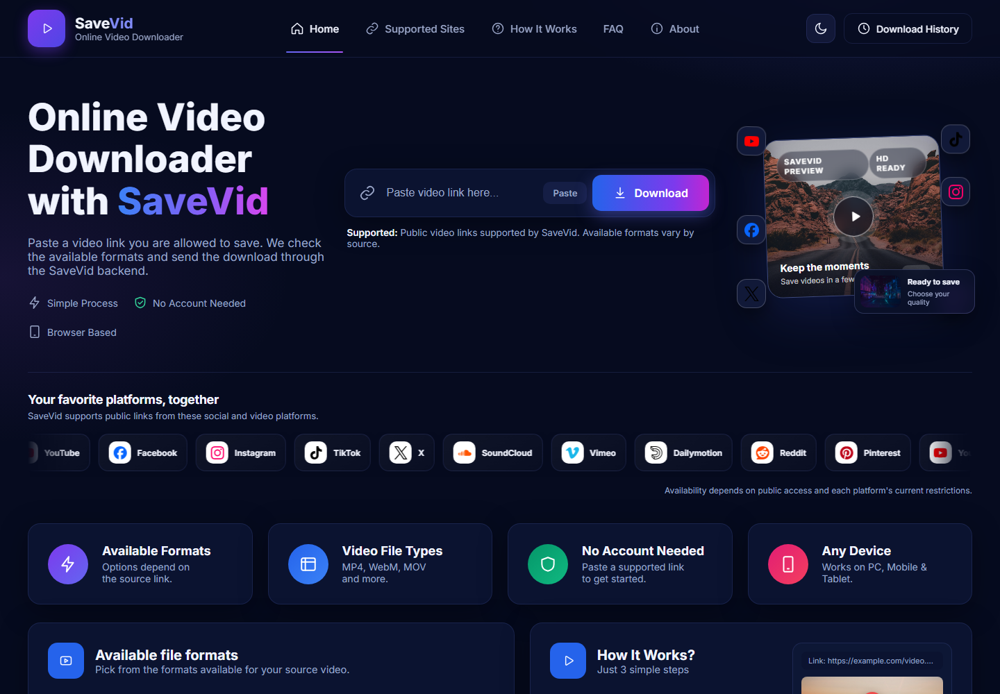
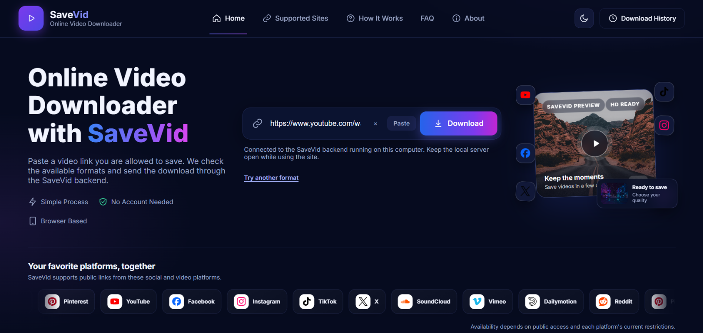
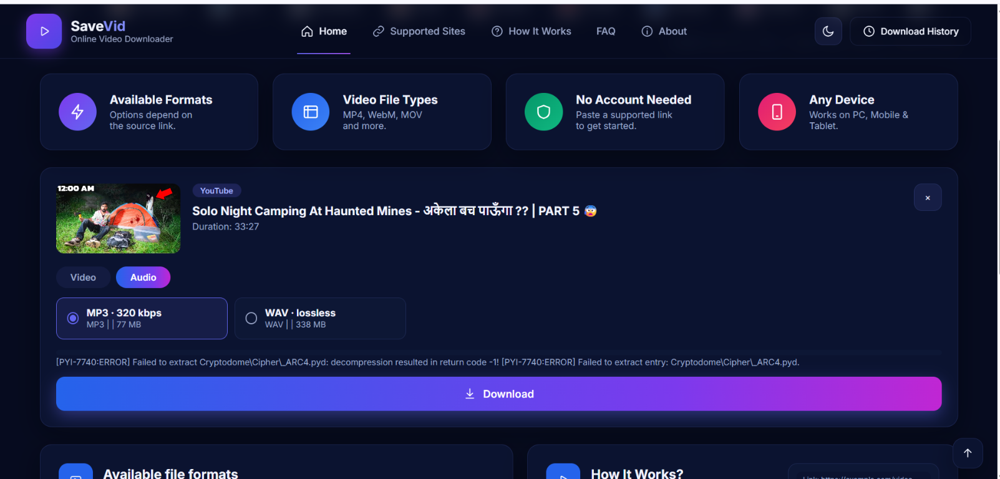
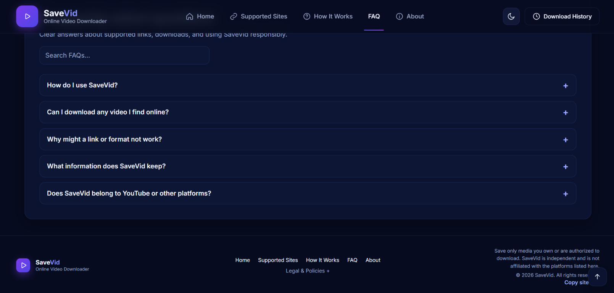
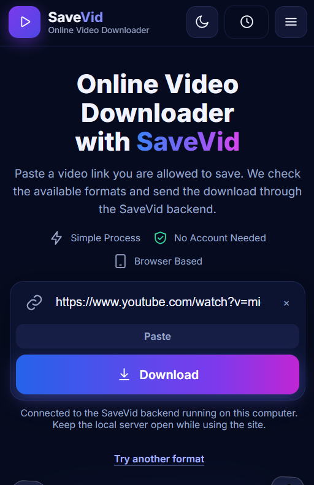
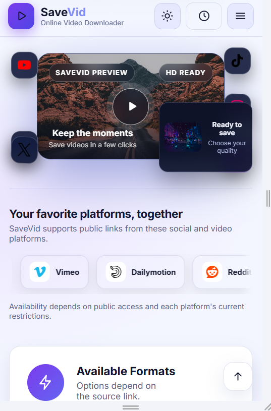

# SaveVid

SaveVid is a browser-based video downloader with a Node.js backend. The same
server serves the website and its `/api` routes.

## Screenshot



### More app screenshots











## Run locally

Install Node.js, then run:

```powershell
node server.js
```

Open `http://localhost:8899`. The backend uses the bundled `resources/yt-dlp.exe`
on Windows. Its temporary downloads are stored in the operating system's temp
directory; keep enough disk space available for the selected video.

## Deploy to Render

The included `render.yaml` describes a free Render web service. Push this
project to a GitHub repository, then create a Render Blueprint from that
repository. Render will build and start the Node service and check `/healthz`.
Open the assigned `onrender.com` address to use the app on other devices.

The SaveVid backend is deployed at
<https://savevid-d85v.onrender.com>. YouTube requests from the Vercel site try a
backend running on the same device first, then use the hosted backend as a
fallback.

Free services may sleep while idle, have temporary storage, and take time to
wake. YouTube can also block requests from a hosting provider's network, so
deployment does not guarantee that every source or video will work.

## Vercel

`vercel.json` and `api/index.js` are retained for the existing Vercel
deployment. YouTube requests try the local backend on the same device first,
then fall back to Render. A phone's `127.0.0.1` is the phone, not another
computer; the local backend must be running on that device to use this fast
path. Free hosting networks can still be blocked by YouTube.

## Secrets

Do not commit API keys, `.env` files, or `config.json`. The local config file
is ignored by Git. Configure any future hosted secrets only through the
hosting provider's private environment-variable settings.